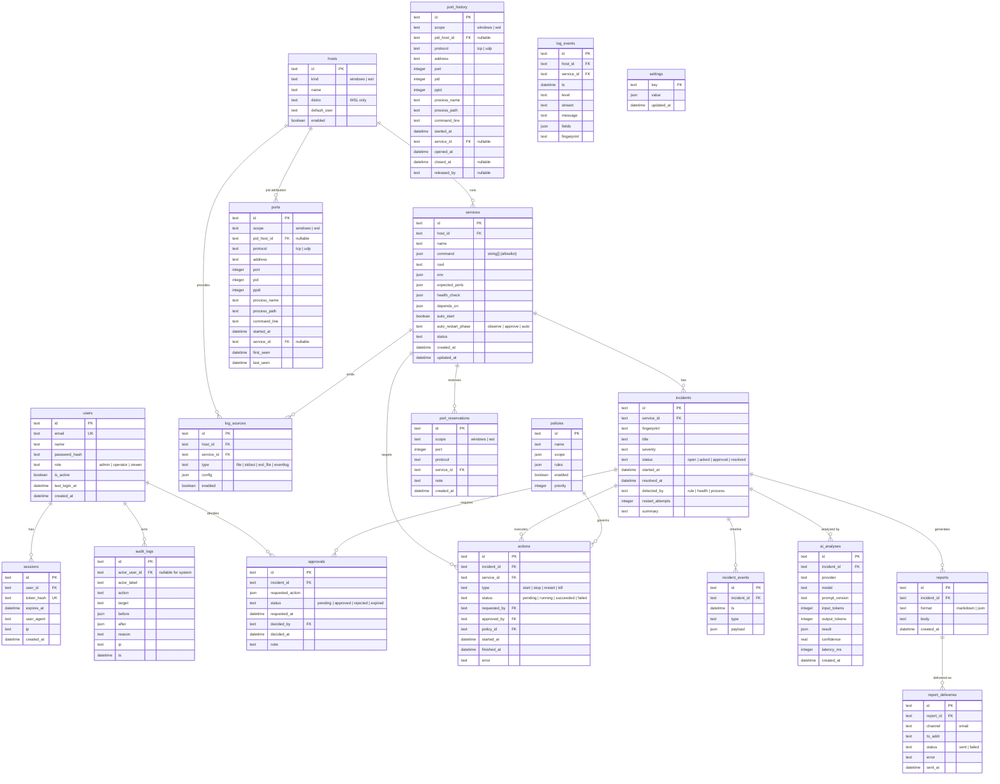

# ER 図 / データモデル詳細

- 版: 1.0（M0 成果物）
- 対象: SQLite（初期） / PostgreSQL（将来）
- 正: `PLAN.md` の「6. データモデル」と本ドキュメント

---

## 1. ER 図

---

## 2. テーブル補足

### 2.1 ポートのスコープ

WSL 3.x では distro 間でネットワーク名前空間が共有されるため、`ports.scope` は `windows` / `wsl` の 2 値。

- `pid_host_id` は「PID を観測できた WSL distro」。他 distro からは `pid=null` に見える
- 停止・再起動は `pid_host_id` の distro 内で実行する
- 同じポートが複数 distro から見えるため、保存時は `(scope, protocol, address, port)` で upsert する
- Windows 側の `wslrelay.exe` は `scope=windows` のまま残し、UI で「WSL フォワーディング」と注記する

### 2.2 ログの粒度

- `log_events` は 1 行 1 ログ。`ts` は UTC（ISO 8601）で保存
- `host_id` は実行ホスト（Windows / WSL distro）。ポートの `scope` とは別
- 検索用に `message` の全文インデックス（SQLite は FTS5、PostgreSQL は `tsvector`）を用意
- `fingerprint` は正規化したメッセージ（数値・ID・パスをマスク）のハッシュ

### 2.3 インシデントの重複排除

- 同一 `service_id` + `fingerprint` が既定 10 分以内に再発した場合は既存インシデントに `incident_events` を追加
- 解決後も 10 分以内なら再オープン
- `status` 遷移: `open` → `acked` → `approval` → `resolved`（失敗時は `open` に戻す）

### 2.4 承認とアクション

- `approvals.requested_action` は `{ "type": "restart", "service_id": "..." }` のような JSON
- 承認後に `actions` を作成し、実行結果を `actions.status` に反映
- `actions.requested_by` / `approved_by` は `users.id`。システム起因は `NULL` + `audit_logs.actor_label = "system"`

### 2.5 設定の秘密値

- `settings.value` に SMTP パスワードや AI API キーを入れる場合、アプリ層で AES-256-GCM 暗号化した文字列を保存
- 鍵は OS 資格情報ストア（Windows Credential Manager）またはローカル鍵ファイル（`0600` 相当）
- API 応答では常にマスク（`********`）し、`GET /settings/*` で平文を返さない

---

## 3. 制約・インデックス

| テーブル            | 制約 / インデックス                                          |
| ------------------- | ------------------------------------------------------------ |
| `users`             | `email` UNIQUE、`role` CHECK                                 |
| `sessions`          | `token_hash` UNIQUE、`expires_at` INDEX                      |
| `hosts`             | `(kind, distro)` UNIQUE（WSL）、`kind` CHECK                 |
| `services`          | `(host_id, name)` UNIQUE                                     |
| `ports`             | `(scope, protocol, address, port)` UNIQUE、`port` INDEX      |
| `port_history`      | `(scope, port, opened_at)` INDEX、`closed_at` INDEX          |
| `port_reservations` | `(protocol, port)` UNIQUE（Windows / WSL 横断）              |
| `log_events`        | `(host_id, service_id, ts)` INDEX、`(fingerprint, ts)` INDEX |
| `incidents`         | `(fingerprint, started_at)` INDEX、`status` INDEX            |
| `approvals`         | `status` INDEX、`incident_id` INDEX                          |
| `actions`           | `(service_id, started_at)` INDEX                             |
| `audit_logs`        | `(ts)` INDEX、`actor_user_id` INDEX                          |
| `settings`          | `key` PK                                                     |

外部キーは SQLite の `PRAGMA foreign_keys = ON` を前提。削除は原則ソフトデリートではなく、`is_active` / `enabled` で無効化する（ログ・監査の参照整合性を保つ）。

---

## 4. 保持・削除

| データ                                  | 保持                         |
| --------------------------------------- | ---------------------------- |
| `log_events`                            | 既定 14 日。日次で削除ジョブ |
| `incidents` / `reports` / `ai_analyses` | 無期限（手動削除のみ）       |
| `audit_logs`                            | 無期限                       |
| `sessions`                              | 期限切れから 7 日後に削除    |
| `report_deliveries`                     | 90 日                        |

---

## 5. マイグレーション方針

- Drizzle ORM の `drizzle-kit generate` で SQL を生成し、起動時に `migrate()` を実行
- SQLite → PostgreSQL の移行を見据え、以下を避ける
  - SQLite 固有の `AUTOINCREMENT` に依存した ID（ULID / UUID をアプリ側で生成）
  - `json1` 拡張前提の検索（JSON は保存のみ、検索は別カラム）
  - boolean の 0/1 前提（ORM で吸収）
